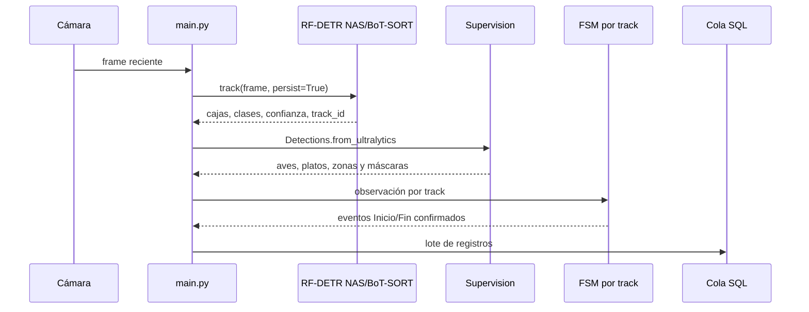

# Arquitectura del Monitor de Ninfas

## Alcance

El proyecto se divide en dos procesos principales:

1. `main.py` procesa video y audio, mantiene estado temporal y escribe eventos.
2. `app.servidor` consulta Azure SQL y sirve la API, el panel y el asistente.

Pueden ejecutarse en el mismo equipo, pero no comparten memoria. Azure SQL es
el contrato entre ambos. `app.servidor_agente` es un tercer proceso opcional y
reducido para exponer solamente herramientas de lectura.

## Flujo de video



`CamaraStream` conserva únicamente el frame más reciente. Así evita procesar
un buffer atrasado cuando la inferencia tarda más que la captura.

### Responsabilidades de Ultralytics y Supervision

- `DetectorRFDETR` carga el modelo Roboflow configurado mediante Inference y
  adapta sus predicciones a `ultralytics.Results`. La entrada NAS es 640×640.
- Ultralytics conserva los IDs con BoT-SORT. Solo carga `best.pt` para inferencia
  si se selecciona expresamente `NINFAS_DETECTOR=yolo`.
- Supervision convierte el resultado a una representación común, filtra por
  clase, confianza y área, evalúa `PolygonZone` y dibuja cajas, etiquetas y
  trazas.
- No se ejecuta ByteTrack de Supervision. Mantener un solo tracker evita IDs
  contradictorios.

Si BoT-SORT falla durante la sesión, `main.py` se degrada a `predict` y reintenta
tracking después de una pausa de 30 segundos. En ese
modo siguen existiendo detecciones, pero no se generan observaciones de
comportamiento que requieran `track_id`.

## Zonas y estados

`GestorZonas` admite dos fuentes:

- Polígonos fijos normalizados desde `ZONA_COMEDERO` y `ZONA_BEBEDERO`.
- Rectángulos dinámicos con 20 % de margen alrededor de cada plato detectado.

El disparador es el centro de la caja del ave. La prioridad de observación es:

1. Dentro de ambas zonas: `DESCONOCIDO`, porque la evidencia es ambigua.
2. Dentro de comedero: `COMIENDO`.
3. Dentro de bebedero: `BEBIENDO`.
4. Fuera de zonas: `ACTIVO`, `INACTIVO` o `DESCONOCIDO` según movimiento.

`GestorComportamiento` mantiene una máquina independiente por track. Un estado
nuevo debe permanecer 1 s para activo, 2 s para comida/bebida y 10 s para
inactividad. La pérdida de un track se tolera durante 3 s. Cada transición
confirmada cierra el estado anterior y abre el nuevo, produciendo eventos con
timestamp, duración, confianza, ave y motivo.

## Identidad individual

`IdentificadorColor` utiliza la región central y la parte superior de la caja
con votos HSV. La segunda región permite reconocer amarillo tenue fuera del
centro del cuerpo; una cara amarilla con cuerpo oscuro queda indeterminada.
La configuración de `Aves` se interpreta mediante estas familias:

- amarilla: amarillo o lutino;
- blanca: blanco o albino;
- gris: gris, plomo, silvestre, plateado u oscuro.

El campo `color` prima sobre `notas`, que solo se usa si no reconoce un tipo
en el primero. «Gris y amarillo» se considera base gris; `lutino` o `albino`
explícitos tienen prioridad sobre colores genéricos. La categoría se elige
antes de comprobar si está ocupada: dos descripciones iguales no se convierten
artificialmente en dos plumajes distintos según el orden del catálogo.

Se requieren al menos ocho votos y una mayoría del 70 %. En la lectura de video,
un cambio de color reinicia los votos: hacen falta ocho observaciones claras
consecutivas. La resolución conjunta impide que dos tracks reciban
simultáneamente el mismo nombre. Color ambiguo o ausencia de saturación —por
ejemplo, visión infrarroja— retiran la asignación y sus votos anteriores.

Si dos cajas de ninfa se superponen al menos un 20 % del área de la menor,
se suspenden ambas identidades hasta obtener ocho observaciones claras tras
separarse. Se conservan las cajas y el movimiento. Una caja con mezcla evidente
de plumaje amarillo y gris también queda sin nombre; si el detector devuelve
una sola caja, esta regla no permite descubrir un ave completamente oculta.

Si un ID del tracker cambia entre dos aves confirmadas, la máquina de
comportamiento cierra el episodio anterior antes de aplicar la nueva identidad
y reinicia su confirmación. Si el nombre estaba suspendido, ese cierre sigue
sin identidad; no atribuye la ingesta anterior al ave recién reconocida.

Esto no es reconocimiento facial ni biométrico. Solo funciona para aves con
tipos de color configurados y visualmente separables.

## Movimiento, audio, salud y ánimo

`MovementMonitor` normaliza los centros por tamaño del frame y mide porcentaje
de la diagonal por minuto. Usa una ventana de 60 s, suavizado exponencial y un
mínimo de 3 s de observación. Los umbrales actuales son:

- `≤ 5`: sedentario;
- `> 5` y `≤ 50`: normal;
- `> 50`: muy activo.

`AudioMonitor` abre el stream RTSP con PyAV, remuestrea a 16 kHz mono y calcula
RMS y frecuencia dominante. La webcam usa `AudioMonitorNulo`.

`HealthMonitor` conserva por ave el último inicio confirmado de alimentación e
hidratación priorizando la sensibilidad clínica: una acción sin identidad se
registra como evento ambiguo y no reinicia el contador individual de las aves
registradas, diferenciando alertas críticas (cero ingestas en la jaula) de
alertas de vigilancia clínica (ingesta sin identificar reciente, pero ave no
confirmada). Los contadores se restauran desde Azure al iniciar.

El ánimo es global:

- alertas de salud + grito → `Desesperado`;
- grito + actividad alta → `Estresado`;
- actividad tranquila + audio no alarmante → `Comodo`;
- resto → `Normal`.

Un cambio necesita mantenerse 10 s antes de convertirse en estado oficial.

## Persistencia

`modulos.base_datos` es el único repositorio SQL. Dentro de cada proceso usa
una conexión compartida protegida por `RLock`, reintenta una vez y descarta una
conexión muerta. El monitor no crea un hilo por evento: `ColaEscrituraBD` tiene
un solo escritor FIFO y confirma cada lote en una transacción.

Las operaciones relacionadas de la API, como desvincular eventos y eliminar
un ave, se ejecutan en una única transacción. Al cerrar el monitor se espera a
que la cola quede vacía.

### Esquema lógico

```text
Aves 1 ─────── 0..N BitacoraAves
 Id                 AveId (nullable)
 Nombre             TrackId (nullable)
 Color              Fecha UTC
 Notas              Categoria / Accion / Estado
                    Valor / Confianza / Notas
```

La relación usa `ON DELETE SET NULL`. Los índices cubren fecha, categoría,
acción y ave. Las migraciones se aplican en orden y se registran en
`SchemaMigrations`.

## API y asistente

Rutas principales del panel:

| Método y ruta | Función |
|---|---|
| `GET /api/health` | Diagnóstico de BD, frescura del monitor y respaldo local |
| `GET /api/estado` | Último snapshot por métrica |
| `GET /api/historial` | Serie temporal entre 1 y 168 horas |
| `GET /api/acciones` | Hasta 500 eventos recientes |
| `GET /api/recomendaciones` | Reglas sobre las últimas 24 horas |
| `GET /api/aves_stats` | Consumo agregado por ave |
| `GET/POST/PUT/DELETE /api/aves` | Administración de aves |
| `POST /api/asistente` | Respuesta de Foundry con herramientas locales |

El asistente no recibe credenciales SQL. El backend ejecuta una lista cerrada:

- `obtener_estado_ave(nombre, horas)`;
- `obtener_recomendaciones_monitor()`.

Los argumentos se validan tanto en el esquema de herramienta como antes de la
consulta. Los textos devueltos por herramientas se tratan como datos no
confiables para reducir prompt injection indirecta.

## Concurrencia y recuperación

| Componente | Ejecución | Recuperación |
|---|---|---|
| Video | Hilo de captura | Backoff de 1 a 10 s |
| Inferencia y FSM | Hilo principal | Tracking degrada a detección |
| Audio | Hilo dedicado | Reintento cada 5 s |
| Azure SQL | Un escritor FIFO | Reconexión y un reintento |
| FastAPI | Proceso separado | Errores SQL públicos como 503 genérico |

El sistema privilegia no inventar datos: sin track no atribuye comportamiento,
sin color no asigna nombre y con zonas ambiguas no decide comida o bebida.
